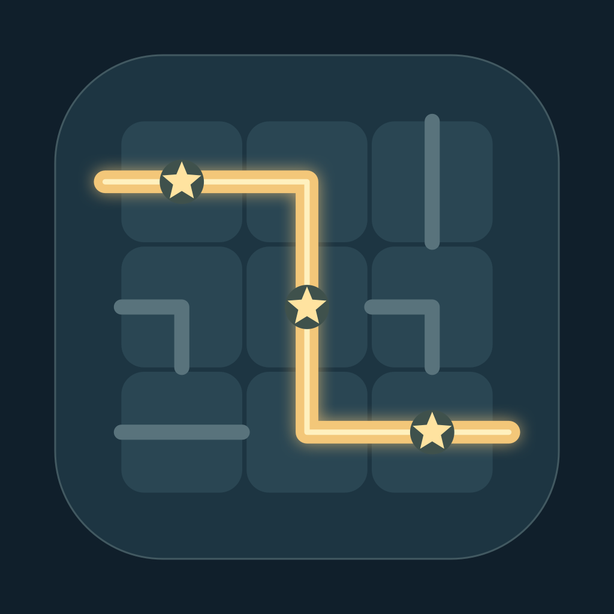
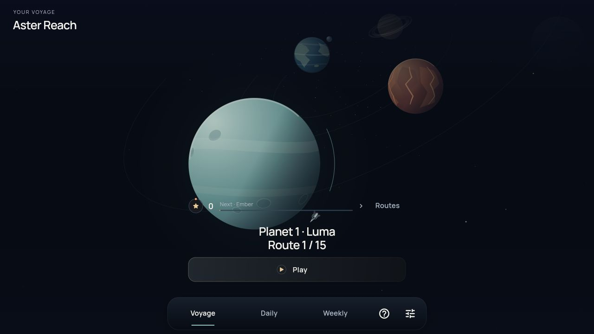
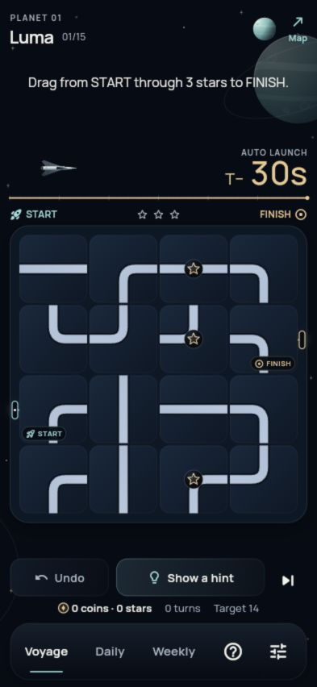
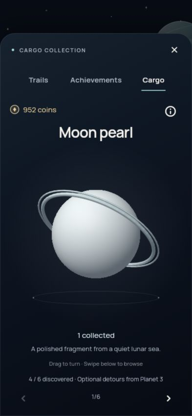

<p align="center">
  
</p>

# Glowpath

**Chart a route. Beat the launch. Explore the next world.**

A space-routing puzzle for web, iPhone, iPad and Android. Designed by [Sandeep Baynes](https://github.com/sandeepbaynes), developed with AI coding agents, and refined through hands-on playtesting.

> **[Play Glowpath in your browser](https://glowpath-38p.pages.dev/)**

[Download the web preview](https://github.com/sandeepbaynes/glowpath/releases) · [Build locally](#run-it-locally) · [Design & engineering notes](#explore-the-project)



## The game

Draw a route from **START**, collect three stars, and reach **FINISH** before the rocket launches. Tiles turn to follow your finger. A promising shortcut might miss a star; a linked tile might disturb a path you already built. The challenge is to see the whole route.

- **Voyage:** 15 routes per planet, with progressively tighter launch windows. Fifty authored celestial destinations lead into deterministic variations beyond 500 planets.
- **Evolving rules:** locked and directional lanes, linked twins and triplets, bridges, crossways, wormholes, gravity forks, shields and weapons.
- **Daily and weekly challenges:** short sequences with faster clocks, clean-streak records and personal bests.
- **Optional discoveries:** take a detour for cargo, earn coins, unlock trails and achievements, and inspect collected objects in a rotatable 3D gallery.
- **A shared experience across screens:** mouse, touch and keyboard input; responsive phone/tablet layouts; and a two-pane experience on partially open foldables. Gameplay, maps, briefings and panels keep content clear of the hinge.

The current plan is free access on phones, tablets, foldables, the web and a future watch edition: no paid downloads, subscriptions, in-app purchases, paywalled levels or currency bought with money. Coins are earned through play. Native mobile advertising is being prepared with consent controls and test-device review. The public website serves no ads while AdSense/H5 approval and browser integration are pending.

The planned watch edition will offer a complete, ad-free game that can be played on its own, with an optional, unobtrusive way to discover the phone app. An [experimental native watchOS preview](watch/README.md) includes a small routing board, timed flights, hints and local scores. It builds with the watchOS SDK; the simulator runtime is installed and playtesting remains pending. The full watch edition, phone discovery and earned-reward sync are not implemented yet.

### Designed for each device

| Device | Interaction and layout decision | Status |
| --- | --- | --- |
| iPhone and Android phone | Finger-drawn routes; compact, safe-area-aware mission controls and launch clock. | Flutter game built; physical iPhone and Android 7.0/16 emulator launch review complete. |
| iPad, Android tablet and desktop web | Keep the board a comfortable size; use the additional width for the mission panel and map. Mouse, keyboard and touch work on web. | Built; responsive review continues. |
| Native macOS, Windows and Linux / Steam Deck | Keyboard, mouse or controller input at a restrained desktop scale; package and verify each operating system separately. | Flutter desktop targets are candidates; no desktop release package yet. |
| Book-style foldable, closed | One-pane phone layout, including a vertical rocket countdown on narrow cover screens. | Adaptive Flutter layout built; simulator review continues. |
| Book-style foldable, half or fully open | Keep the puzzle on one side while the other side carries map, timer and controls; avoid the hinge and animate posture changes. | Adaptive layout built; physical fold testing pending. |
| Flip-style foldable | Give the two halves separate jobs when partly open; return to a single game surface when closed. The external cover display is a separate, unbuilt target. | Posture layouts built; physical flip testing pending. |
| Apple Watch and Wear OS | A short, self-contained, ad-free routing game that can introduce the phone edition. | watchOS prototype only; Wear OS unbuilt. |
| Apple TV and Android TV | D-pad/remote play, visible focus, couch-distance text and a longer clock to allow for remote input. | Planned; no TV build yet. |
| Apple Vision Pro, Meta Quest, Android XR, PICO and supported PC VR headsets | A spatial puzzle in front of the player, with reach/pinch routing, grabbable planets, elastic spin/flick and a controller alternative. | [Platform and interaction plan](docs/platforms/DEVICE_STRATEGY.md); no XR build yet. |

Flutter 3.50 supports **iOS 15+** and **Android API 24+**, which are the current mobile minimums for this codebase. An app store accepting older OS targets does not make those targets supported by this Flutter version. The native watch, TV and XR editions need their own builds and device testing. [Flutter platform support](https://docs.flutter.dev/reference/supported-platforms).

<p align="center">
  
  &nbsp;&nbsp;
  
</p>

*Actual application captures. The Voyage image is from the 0.11 preview; the mobile gameplay and cargo images document the 0.10 design iteration.*

## Human-led design, AI-assisted development

Glowpath is an ongoing experiment in building software while actively designing it. Sandeep sets the product direction, plays the builds, critiques the details and decides what to keep. AI agents help research, implement, inspect, test and package each iteration.

The workflow is a repeated loop: **describe the experience → build it → play it → give specific feedback → revise and verify**. The useful prompts were often about how something felt: a map that jumped, a timer that lacked urgency, a route that was tiring to tap, or an animation that did not fit the artwork.

| Design feedback | What changed |
| --- | --- |
| Repeated tapping caused finger fatigue. | Drag-to-route aligns compatible tiles, supports backtracking and commits as one undo step. |
| Players could not immediately identify the route's endpoints. | Cyan START and gold FINISH combine labels, symbols and placement. |
| The journey added too many steps before play. | One consistent Voyage landing and one Play action resume the route. |
| Scenery and transitions competed with the puzzle. | Gentle layered motion, shared planet artwork and reduced-motion alternatives. |
| The countdown felt disconnected from the loss animation. | A longer launch path hands the same visible rocket into the timeout flight, including on a foldable's vertical rail. |
| Collection swipes changed the artwork in place. | Trails and Achievements move as finger-following page carousels, with matching chevron navigation. |
| Opening or folding the device should preserve play. | The board stays in one pane from half-open to fully open; the surrounding mission map transitions gently. Clamshell folds become a two-part mission desk; maps, briefings and panels also give each half its own role. |

Parallel agents handled focused work such as layout regressions, native fold integration, portal feedback and packaging reviews. The main game uses custom Flutter-painted artwork and projected cargo meshes. Blender scripts record visual exploration; typography uses bundled Manrope, Atkinson Hyperlegible Next and Lora fonts.

## Engineering behind the experience

The project uses **Flutter and Dart**, with a small Swift bridge for iOS fold geometry. Game rules, generation, scoring and saved progress are separated from rendering and service adapters.

Procedural levels are deterministic and checked for legal solutions. Tests cover connected routes, coupled tiles, independent crossing lanes, portal transfers, replay validation, rewards and save migration. Layout checks exercise phones, tablets, fold postures, enlarged text and touch-target bounds. Reduced motion, semantic labels and keyboard controls are implemented; physical-device accessibility and performance review continue.

The previous **0.11.4** baseline passed 905 Flutter tests and static analysis. Fold review included the iPhone simulator and synthetic Android clamshell layouts; physical-device review continues. The [0.12.1 release notes](docs/release/0.12.1.md) describe the countdown handoff, collection carousels and responsive voyage fixes; [0.12.0](docs/release/0.12.0.md) records the initial public web package and native ad integration. These checks establish behavior within the tested cases; player enjoyment is evaluated by playing the game.

## Run it locally

The current build uses Flutter **3.50.1** and Dart **3.14.0**. Install Flutter, clone this repository, then run:

```sh
git clone https://github.com/sandeepbaynes/glowpath.git
cd glowpath
flutter pub get
flutter run -d chrome
```

The default configuration keeps live ads, purchases and shared leaderboard connections disabled. Progress is saved locally. To exercise labelled demo services during development, add `--dart-define=MOCK_SERVICES=true`.

```sh
flutter analyze
flutter test
python3 -m unittest discover -s tools -p 'test_package_web.py'
```

For iOS, select your own signing team in Xcode. Android store distribution requires your own upload-key configuration; the current release configuration uses debug signing for local review.

## Deploy the web build

Build the public Cloudflare package with publisher ownership metadata, privacy and support pages:

```sh
python3 tools/package_web.py --target cloudflare --mode public --base-href /
```

The package contains self-hosted fonts and renderer files, a file inventory and SHA-256 checksums. Public mode remains free of advertising requests until web approval and integration are complete. Use `--mode preview` for a non-indexed review build without publisher metadata, or download an available package from [Releases](https://github.com/sandeepbaynes/glowpath/releases). [Deployment guide](docs/release/cloudflare/README.md).

**Current status:** playable game under active development, with [glowpath-38p.pages.dev](https://glowpath-38p.pages.dev/) as its public web address. Native ad integration uses the real AdMob account identifiers and consent controls; owner-device review uses test advertising. Web advertising, purchases, Game Center and cross-device sync are not active. The website needs no player account. Read the [privacy notice](https://glowpath-38p.pages.dev/privacy.html) or [get support](https://glowpath-38p.pages.dev/support.html).

## Explore the project

| Location | What you will find |
| --- | --- |
| [`lib/game/`](lib/game/) | Puzzle generation, progression, scoring, challenges and persistence |
| [`lib/ui/`](lib/ui/) | Board interaction, planet rendering, motion and galleries |
| [`lib/services/`](lib/services/) | Platform and service adapters, including explicit development mocks |
| [`test/`](test/) | Gameplay, persistence, interaction and responsive-layout checks |
| [`tools/`](tools/) | Review entry points, rendering experiments and web packaging |
| [`docs/design/`](docs/design/) | Design decisions, research and iteration records |
| [`backend/`](backend/) | An optional, undeployed leaderboard/replay-validation prototype |

Useful reading: [interaction research](docs/design/RESEARCH_EVIDENCE_0_3.md), [visual direction](docs/design/ORBITAL_ART.md), [progression and rewards](docs/design/VOYAGE_REWARDS_0_8.md), and [playtesting](docs/PLAYTEST.md).

The [ad and first-party measurement plan](docs/release/AD_AND_ANALYTICS_PLAN.md) records placements, test-device setup and launch gates. The web build makes no ad requests or backend event uploads; game progress and its bounded event journal remain local to the browser.

Feedback is welcome through [GitHub Issues](https://github.com/sandeepbaynes/glowpath/issues). Include your device/browser, steps to reproduce, and what you expected to happen.

Fonts and dependencies retain their respective licenses; bundled font notices are in [`assets/fonts/`](assets/fonts/).
