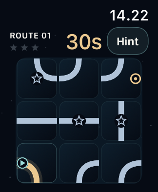
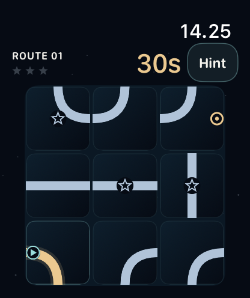
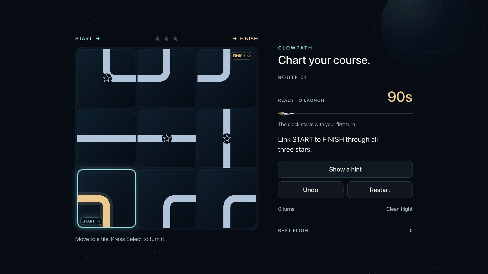
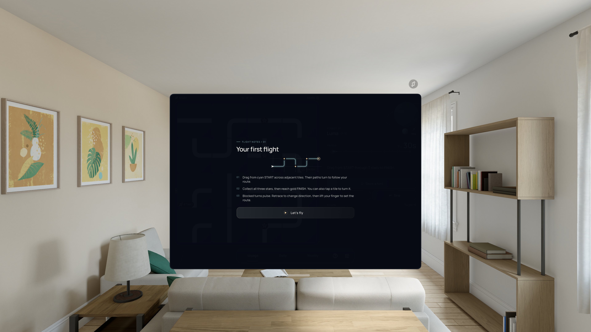

# Apple simulator review — 25 November 2026

These are actual simulator captures, not design mockups. Watch and TV run isolated native previews with five route templates; they are not the full mobile game. Vision Pro runs the existing iPad application in a compatibility window. No store release or public web deployment was made for this review.

| Target | What was verified | Remaining limits |
| --- | --- | --- |
| Apple Watch SE 3, 40 mm, watchOS 27.2 | Briefing, board, tile rotation, Hint, clock start, timeout, Retry, assisted completion and Next flight. | Physical touch accuracy, VoiceOver, haptics, battery and full game content. |
| Apple Watch Series 12, 46 mm, watchOS 27.2 | Briefing and gameplay layout; entry into play. | Full interactive replay was performed on the 40 mm model. |
| Apple TV 4K at 1080p, tvOS 27.2 | D-pad focus, Select rotation, 90-second timer start, hints, Undo, timeout, Retry, assisted completion and Next flight. | Physical remote, accessibility, viewing distance, full game content. |
| Apple TV 4K, tvOS 27.2 | Same binary launched and rendered at 3840×2160 without observed clipping or process exit. | Scaling/launch review only; interactive run used 1080p. |
| Apple Vision Pro, visionOS 27.2 | Built and launched the iPad-compatible app; first-flight interface renders. | Onboarding did not respond to automated pointer or captured keyboard input. Playability is unverified. Native spatial content and hand interactions are unbuilt. |

## Watch

The initial 40 mm briefing clipped its instructions. Shorter explicit lines now explain the start, three-star objective and finish. Removing duplicate safe-area reservations enlarged the board from 90 to 130 points (about 41 points per tile) without introducing scrolling. The START arrow had a path-construction error; it now renders correctly. Both endpoint symbols have dark backing to stay visible against bright paths.

The preview builds with watchOS 10 as its deployment target. The older runtime and physical hardware were not tested in this pass. Build instructions and the remaining feature scope are in [watch/README.md](../../watch/README.md).

## Television

There was no tvOS application target to inspect, so this review added a small SwiftUI target. It adapts the existing watch route rules, using broad pipes, a large board, a mission panel, visible remote focus and a 90-second launch clock. The full mobile Voyage and cinematic loss flight are not included. The timer starts on the first rotation or hint, giving the player time to learn the controls.

The rule checks exercised 150 generated preview routes, star collection, pause, timeout and retained Retry state. The interactive remote playthrough reached Signal delivered, recorded a local best and opened Route 02. This confirms the small preview loop; it does not establish parity with mobile scoring or its obstacle catalogue. See [tv/README.md](../../tv/README.md) for the project and repeatable checks.

## Vision Pro

Xcode's **Designed for iPad** destination built the existing Flutter app for the installed Vision Pro simulator. Ads and purchases were disabled in this debug build. The interface renders in a flat window, with the mobile first-flight briefing above the board.

The small text and flat composition do not deliver the intended spatial experience. Automated attempts to activate Let's fly using pointer clicks and a captured keyboard did not advance the app. A native window control also did not respond during the pointer check. Source and runtime-log inspection found no concrete app-side input blocker; the cause remains unresolved between app compatibility and simulator input delivery. Do not treat this as a playable Vision Pro release.

The next spatial milestone remains a native RealityKit/SwiftUI scene: one reachable puzzle, one grabbable planet, elastic release and a complete rocket journey, with accessible controller alternatives and real-device hand testing. [Apple compatibility guidance](https://developer.apple.com/documentation/visionos/making-your-app-compatible-with-visionos) describes the current flat-window mode; the intended experience is recorded in [Device strategy](DEVICE_STRATEGY.md).

## Build evidence

- watchOS preview: build, install and launch passed on both selected sizes.
- tvOS preview: build, install and launch passed at 1080p and 4K; 150-route rule checks passed.
- Vision Pro compatibility: iPad simulator build, installation and initial rendering passed; interaction remains unverified.
- Main Flutter game source, mobile release version and live website were unchanged by this review.
